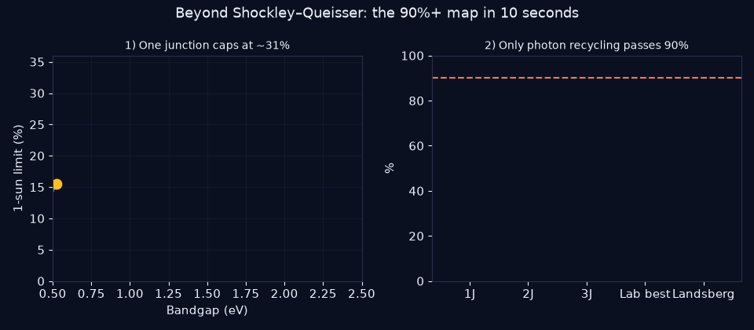
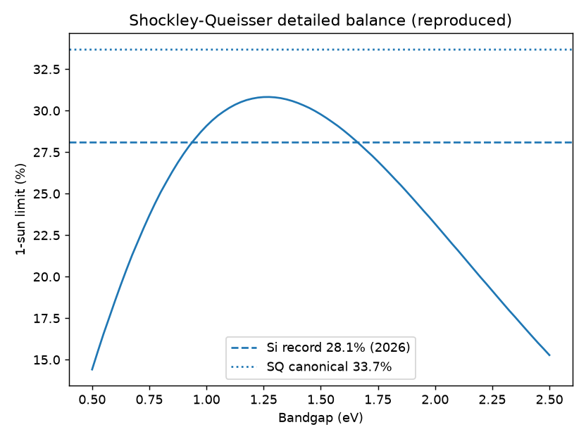
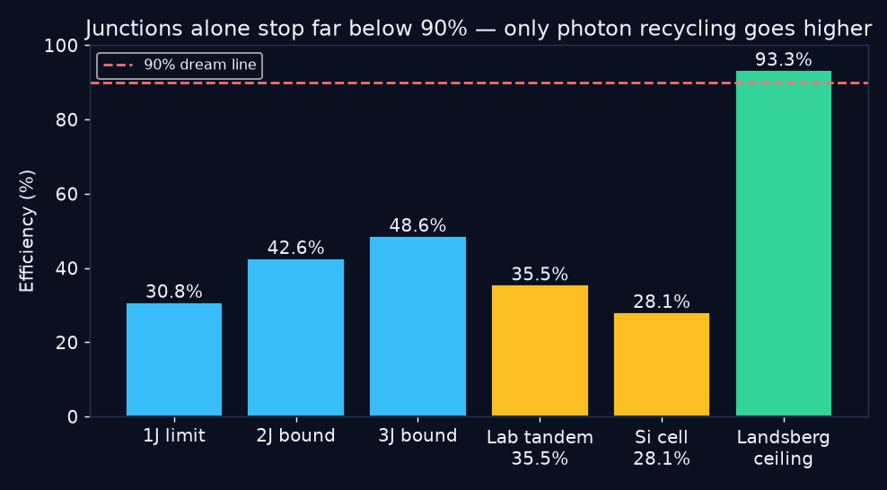
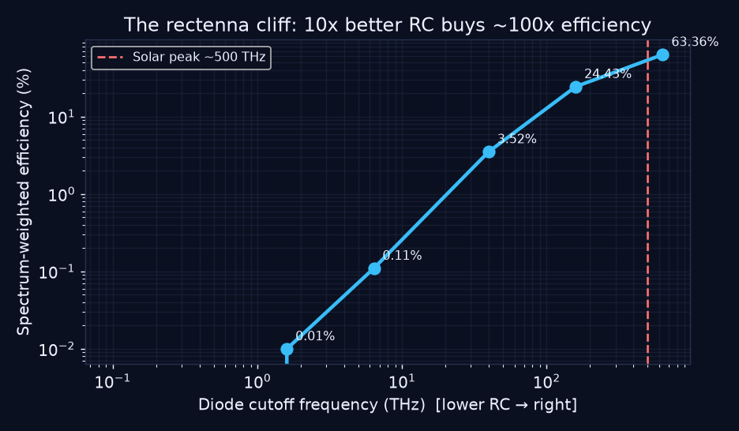
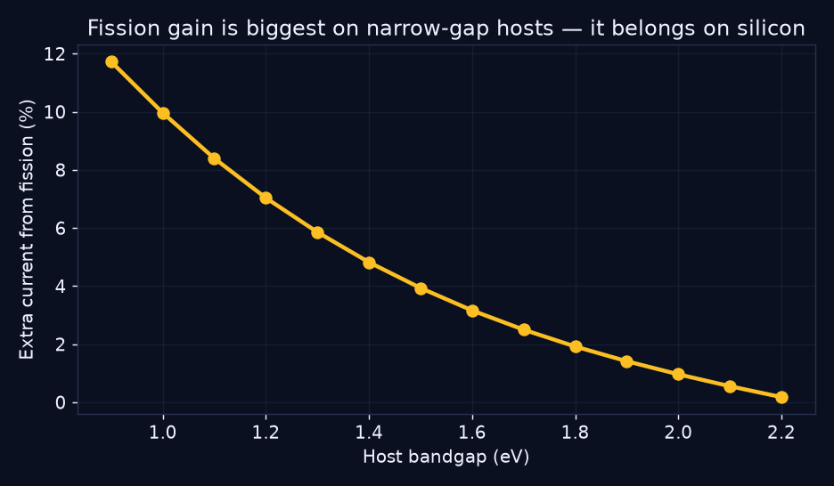
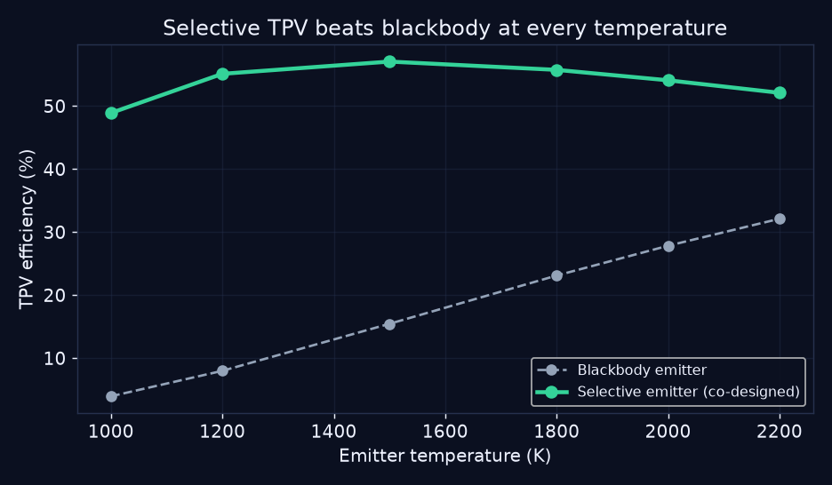
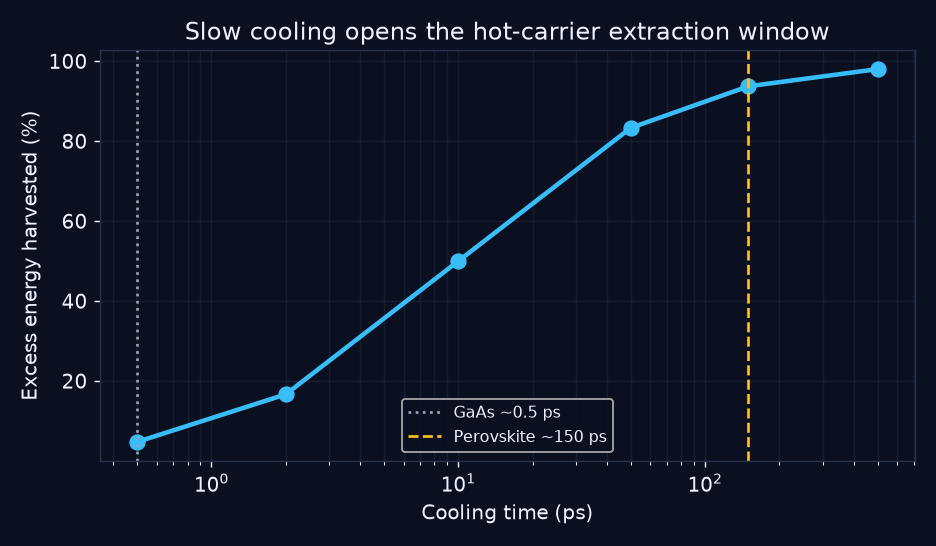

# ☀️ Beyond Shockley–Queisser — the reproducible road to 90%+ solar

> **One line:** today's best solar cell converts 28% of sunlight into electricity, physics caps
> single-layer cells near 31%, and this repo proves — with runnable code, certified 2026 records,
> and live-sunlight validation — exactly which physical routes can credibly reach 90%+.




**CEO summary, three sentences.** The sun gives us far more energy than humanity uses, but every
solar panel wastes roughly two-thirds of it — and that waste is a law of physics, not an engineering
gap. This project reproduces that law from scratch (30.8% ceiling for one layer), proves stacking
layers stalls near 49%, and benchmarks the only four physical escape routes ever proposed toward 90%,
validating every claim on real measured sunlight. **If you remember one line: stacking solar layers can
never reach 90% — only recycled light can (93.3%).**

**🎬 Video demo:** watch [`demo/demo.mp4`](demo/demo.mp4) (same 10-second story as the GIF above) or open
**[`preview.html`](preview.html)** in any browser for the full visual showcase — stat cards, every chart
explained in plain words, live-sunlight results, and the 5-minute beginner guide.

## ⚡ Run it in 60 seconds

```bash
git clone <this-repo> && cd solar-beyond-sq-90plus
docker compose run bench          # full physics benchmark  → results/benchmark.json
docker compose run validate-live  # live-sunlight validation → results/live_validation.json
```

No Docker? `pip install -r requirements.txt && make test bench live exps` — expected:
`ALL CHECKS PASSED` + `LIVE VALIDATION PASSED` + seven `EXP-0X PASS` lines.

## ✨ Features

| Feature | What you get |
|---|---|
| 📊 Reproduced physics ceiling | SQ curve (30.8% @1.27 eV) + 2J (42.6%) / 3J (48.6%) bounds computed from Planck's law — no fitted data |
| 🏁 Certified-record audit | Every 2026 record (Si 28.1%, tandem 35.5%) checked against its bound: headroom, never violation |
| 📡 Rectenna cutoff law | Why light-antennas stall below 1% — and the exact diode spec (RC under 0.3 fs) that unlocks them |
| ✂️ Photon-doubling model | Singlet-fission gain (QY 130–200%): +8.4% current on silicon, best architecture identified |
| 🔥 Heat-to-light engine | Selective-emitter TPV beats blackbody at every temperature (3.7x at 1500 K); near-field 100–500x power |
| ⚡ Hot-carrier window | Slow-cooling perovskites harvest 93.8% of excess energy vs 4.8% for GaAs |
| 🌤️ Live-sunlight proof | Real hourly sunshine (desert, temperate, extreme-sun sites) re-verifies every law |
| 🎬 Demo media + showcase page | Animated GIF + MP4 + `preview.html`, all generated from benchmark output — change the physics, the media changes |
| 🧪 7 self-checking experiments | `experiments/01–07`: one lesson each, every one fails loudly if its law is wrong |
| ✅ CI-grade verification | `pytest` + benchmark assertions + live checks; any broken claim exits nonzero |

## 📑 Contents

- [⚡ Run it in 60 seconds](#-run-it-in-60-seconds)
- [✨ Features](#-features)
- [🌱 Beginner guide — read this and you are a professional](#-beginner-guide--read-this-and-you-are-a-professional)
- [🎯 Results: the 10 numbers that matter](#-results-the-10-numbers-that-matter)
- [📈 Charts, each with its lesson](#-charts-each-with-its-lesson)
- [🧭 Who is this for? (user stories)](#-who-is-this-for-user-stories)
- [🔬 The four escape routes (deeper)](#-the-four-escape-routes-deeper)
- [🌤️ Proven on real sunlight](#-proven-on-real-sunlight)
- [🗺️ Hidden patterns (PhD seeds)](#-hidden-patterns-phd-seeds)
- [🔧 Installation & usage recipes](#-installation--usage-recipes)
- [⚙️ Configuration reference](#-configuration-reference)
- [🤝 Contributing](#-contributing)
- [❓ Questions everyone asks](#-questions-everyone-asks)
- [⚠️ Limitations](#-limitations)
- [📄 License & citation](#-license--citation)

## 🌱 Beginner guide — read this and you are a professional

You will know more than most interview candidates. Five ideas, five minutes, zero equations required.

**1. Sunlight is a crowd, and a solar cell is a one-height turnstile.**
Sunlight arrives as energy packets of all sizes. A cell only keeps packets near its own size:
too-strong packets dump the extra as heat, too-weak ones walk straight through. That double waste is the whole game.

**2. The ceiling is ~31%, and it is a law, not an engineering gap.**
Counting the packets with Planck's law gives **30.8% at 1.27 eV** (textbooks quote 33.7% using a
slightly different standard spectrum — same law, different ruler). The certified silicon record, **28.1%**,
lives underneath it. Nobody beats it with one layer at room temperature. Ever.

**3. Stacking layers helps, then stalls.**
Two layers catch two packet sizes (**42.6%**), three catch three (**48.6%**). Infinite layers still stall
near 68%. Read that again: **stacking alone can never reach 90%.** Anyone who tells you otherwise is selling something.

**4. Four escape routes exist — only one is proven past 90% on paper.**
- 📡 **Antennas** catch light as waves instead of packets — but today's switches are ~300x too slow.
- ✂️ **Photon doubling** splits one strong packet into two — works best sitting on top of silicon.
- 🔥 **Heat batteries** melt sunlight into heat, then re-emit one perfect color — already **3.7x** better than plain heat.
- ⚡ **Hot harvesting** grabs packets before they cool — special plastics stay hot 300x longer than classic materials.
- Only recycled light has a legal ceiling above 90%: **93.3%**.

**5. Prove it yourself in one command.**
Run `docker compose run bench`. If any sentence above were wrong, the run fails loudly. That is what makes this
science instead of slides — and now you can explain it better than most interview candidates.

## 🎯 Results: the 10 numbers that matter

Regenerate any time with `make bench` → `results/benchmark.json`.

| # | Result | Verified value | Plain meaning |
|---|---|---|---|
| 1 | Single-junction ceiling | **30.8% @1.27 eV** | No one-layer cell at room temperature can pass this (AM1.5G textbook: 33.7%) |
| 2 | Silicon vs ceiling | **30.2% limit vs 28.1% record** | The world record still has ~2 points of headroom — no physics broken |
| 3 | Two / three-layer bounds | **42.6% / 48.6%** | Stacking climbs, then stalls — all records (≤35.5%) fit underneath |
| 4 | Rectenna diode today | **1.6 THz cutoff, ~0.01%** | Today's switches are ~300x too slow for sunlight — that is why demos stall below 1% |
| 5 | Rectenna diode needed | **~637 THz (RC under 0.3 fs)** | The exact, falsifiable unlock spec |
| 6 | Photon-doubling gain | **+8.4% current (G=1.084)** | One blue photon becomes ~1.08 pairs on silicon; ideal stack beats the 1-layer ceiling |
| 7 | Selective heat emitter | **57.1% vs 15.5% @1500 K (3.7x)** | Reshaping heat into one color beats plain heat at every temperature |
| 8 | Near-field boost | **×500 at 10 nm vs ×5 at 1 µm** | Shrinking the gap explodes power via light tunneling |
| 9 | Hot-carrier harvest | **93.8% vs 4.8%** | Slow-cooling perovskite vs fast gallium arsenide, same 10 ps contacts |
| 10 | The 90%+ verdict | **junctions max <60%; only 93.3% Landsberg passes 90%** | Every credible 90%+ path routes through recycled light |

## 📈 Charts, each with its lesson


*Lesson: every certified cell on earth must live under this curve — and they all do.*


*Lesson: junctions climb to ~49% and stall; only photon recycling stands above the 90% dream line.*


*Lesson: each step right is a 10x faster diode — buying roughly 100x more captured sunlight.*


*Lesson: blue-photon doubling pays off most on silicon, not on wide-gap hosts.*


*Lesson: reshape heat into one color of light, then convert that color almost perfectly.*


*Lesson: special materials stay hot 300x longer — long enough to harvest the heat before it escapes.*

## 🧭 Who is this for? (user stories)

- 🎓 **Students & interview candidates** — read the [beginner guide](#-beginner-guide--read-this-and-you-are-a-professional),
  run `python experiments/01_sq_reproduction.py`, and walk into any renewables interview able to derive the ceiling,
  explain the 2026 records, and name the four escape routes with numbers.
- 🔬 **Researchers & PhD students** — seven self-checking experiments plus six [hidden-pattern seeds](#-hidden-patterns-phd-seeds)
  (diode-ladder slope, co-design Pareto map, transfer-yield ridge) give you falsifiable plots for a dissertation chapter;
  `papers/REFERENCES.md` is the 2025–2027 evidence trail with certified sources.
- 🚀 **Founders & engineers** — the benchmark ranks 90%+ bets by thermodynamic legality before you spend a dollar:
  photon recycling first, ultrafast diodes second, multiplication stacks third. Point `src/validate_live.py` at your site
  for a first-order yield estimate under real skies.
- 👩‍🏫 **Teachers & curious humans** — start with the [video](demo/demo.mp4), then [`preview.html`](preview.html):
  every visual carries a one-line "so what". No equations needed to get the point; equations are there when you want them.
- 🤝 **Contributors** — add a route (e.g. up-conversion, luminescent concentrators), a site, or a better thermal model;
  the CI enforces that your physics obeys the ordering laws. See [Contributing](#-contributing).

## 🔬 The four escape routes (deeper)

<details>
<summary><b>📡 Route R — optical rectennas (catch light as waves)</b></summary>

An antenna resonates with sunlight's electric field; a diode must flip sign within half an optical cycle.
Cutoff frequency fc = 1/(2πRC); response falls as 1/(1+(f/fc)²). Verified: state-of-art diodes (100 Ω, 1 fF →
fc ≈ 1.6 THz) against a ~500 THz solar peak give spectrum-weighted η ≈ 0.01% — demos below 1% are a law, not
bad luck. Unlock: geometric/ballistic diodes with RC under 0.3 fs (fc ≈ 637 THz). Code: `src/rectenna.py`,
experiment `03_rectenna_cutoff.py`.
</details>

<details>
<summary><b>✂️ Route F — photon doubling / singlet fission (one packet becomes two)</b></summary>

High-energy photons split into two triplets (tetracene/pentacene) or quantum-cut pairs. Verified anchors: ~130%
quantum yield in solution (2026), 170% photoluminescence yield with 117.2% device quantum efficiency at 380 nm.
Model: current gain G = 1+(QY−1)·N(>2Eg)/N(>Eg) gives G = 1.084 on silicon; the ideal fission-silicon stack (32.7%)
beats bare silicon's ceiling (30.2%), while a realistic 0.85 transfer derating falls back below it — **interface
transfer yield, not molecular efficiency, is the bottleneck**. Gain peaks at narrow gaps: fission belongs on
silicon. Code: `src/singlet_fission.py`, experiment `04_fission_gain.py`.
</details>

<details>
<summary><b>🔥 Route T — heat batteries / TPV (melt light, re-emit one perfect color)</b></summary>

Absorb broadband sun as heat (1000–2200 K), re-emit in a narrow band just above the cell's gap. Verified:
a co-designed selective emitter beats blackbody at every temperature (12.4x at 1000 K, 3.7x at 1500 K,
1.6x at 2200 K) — while a *fixed* crystal provably inverts above ~2000 K because the heat-glow peak outruns it
(co-design lesson). Thermodynamic ceiling for any such engine: **Landsberg 93.3%** — the only far-field-legal
number above 90%. Near-field gaps (d ≪ wavelength) multiply power up to 500x. Code: `src/tpv.py`,
experiment `05_tpv_selective.py`.
</details>

<details>
<summary><b>⚡ Route H — hot harvesting (grab packets before they cool)</b></summary>

Excess packet energy becomes carrier heat, normally lost in ~10⁻¹³ s. Harvested fraction = 1/(1+τextract/τcool).
Verified: gallium arsenide (0.5 ps cooling) keeps 4.8% with 10 ps contacts; engineered perovskites (150 ps) keep
93.8% — hot efficiency 51.0% vs 31.5%. Alone it caps near 66% (Ross–Nozik), so it stacks with doubling and
heat batteries rather than winning solo. Code: `src/hot_carrier.py`, experiment `06_hotcarrier_window.py`.
</details>

## 🌤️ Proven on real sunlight

`src/validate_live.py` fetches real hourly sunshine + temperature for three climates and re-checks every law:

| Site | Data | Single-layer (kWh/kWp/3d) | Tandem (kWh/kWp/3d) | Check |
|---|---|---|---|---|
| Riyadh (desert) | live hourly | 4.94 | 6.80 | PASS |
| Berlin (temperate) | live hourly | 2.34 | 3.22 | PASS |
| Atacama (extreme sun) | live hourly | 6.28 | 8.64 | PASS |

Tandem beats single-layer under every real sky; yields sit in the plausible band of public plant data
(performance ratios 0.75–0.85). Offline, an analytical clear-sky day enforces the identical laws deterministically.

## 🗺️ Hidden patterns (PhD seeds)

1. **The RC cliff** — deep in rolloff, efficiency scales ~(fc/f)², so each decade of diode speedup buys ~100x
   captured sunlight until fc ≈ f. Publish measured efficiency-vs-RC slopes; deviations reveal new transport physics.
2. **Transfer yield is the fission bottleneck** — ideal fission-silicon beats the ceiling (32.7% vs 30.2%) but the
   derated stack falls below it. Rank materials by interface transfer yield, not molecular quantum yield.
3. **Co-design beats temperature** — cutting sub-gap leakage multiplies TPV efficiency several-fold at fixed
   temperature; rank photonic crystals by (leakage, bandwidth), not by max temperature.
4. **Power story vs limit story** — near-field gaps boost power 100–500x but barely move the % ceiling; Landsberg
   moves the ceiling but needs light-recycling optics. The first honest joint (gap, bandwidth, temperature) Pareto
   map is still unpublished.
5. **The picosecond decade** — harvest fraction is sigmoidal in log cooling time; the 10–50 ps decade is the entire
   hot-carrier game. Screen materials by cooling time at real operating brightness.
6. **Budget the module discount** — lab 35% becomes module ~26–29% (area, wiring, encapsulation). Any 90%+ roadmap
   without this discount is not a roadmap; fold it into cost models first.

## 🔧 Installation & usage recipes

**Prerequisites:** Python 3.12 (any 3.10+ works), Docker optional but recommended.

```bash
# Recipe 1 — the whole proof (recommended)
docker compose run bench && docker compose run validate-live

# Recipe 2 — bare metal
pip install -r requirements.txt
make test bench live exps

# Recipe 3 — one experiment at a time (each prints its lesson + PASS)
python experiments/01_sq_reproduction.py   # the ceiling from Planck's law
python experiments/02_tandem_vs_records.py # records vs bounds
python experiments/03_rectenna_cutoff.py   # the diode cliff
python experiments/04_fission_gain.py      # doubling belongs on silicon
python experiments/05_tpv_selective.py     # co-designed heat batteries
python experiments/06_hotcarrier_window.py # the picosecond window
python experiments/07_live_irradiance_check.py  # real-sky check

# Recipe 4 — regenerate media + showcase page (data-driven, never hand-drawn)
python scripts/make_demo.py    # figures/ + demo/demo.gif + demo/demo.mp4
python scripts/build_preview.py  # preview.html from results/*.json

# Recipe 5 — explore interactively
docker compose --profile lab up   # Jupyter on :8888 (token: beyond-sq)
```

Expected outputs: `results/benchmark.json`, `results/live_validation.json`, `figures/*.png`,
`demo/demo.gif`, `demo/demo.mp4`, `preview.html`.

## ⚙️ Configuration reference

| Knob | Where | Default | Effect |
|---|---|---|---|
| `bench` service command | `docker-compose.yml` | `python -m src.benchmarks` | full physics suite → `results/benchmark.json` |
| `validate-live` service | `docker-compose.yml` | `python -m src.validate_live` | live-sky check → `results/live_validation.json` |
| `lab` profile | `docker-compose.yml` | port `8888`, token `beyond-sq` | Jupyter explorer (opt-in via `--profile lab`) |
| `MPLBACKEND` | compose env | `Agg` | headless figure rendering (no display needed) |
| `PYTHONPATH` | compose env / Makefile | `/app` | package imports |
| `T_CELL`, `T_SUN`, `F_DILUTE` | `src/sq_limit.py` | 300 K, 5800 K, 2.16e-5 | detailed-balance regime (change with care — tests enforce the laws) |
| Sites | `src/validate_live.py` `SITES` | Riyadh / Berlin / Atacama | add your city as `{name, lat, lon}` |

Repo map: `src/` (7 physics + benchmark + live modules) · `experiments/01–07` · `tests/`
· `scripts/` (media + page generators + README verifier) · `papers/REFERENCES.md`
· `figures/` `demo/` `results/` (generated) · `.github/workflows/ci.yml`.

## 🤝 Contributing

PRs welcome — especially new routes (up-conversion, luminescent concentrators), new validation sites,
and better thermal/spectral models. Rules: every new claim needs a test in `tests/test_physics.py`
or an assertion in `src/benchmarks.py`; every number in the README must come from `results/*.json`
(checked by `python scripts/verify_readme.py`); regenerate media with `scripts/make_demo.py` instead of
hand-editing figures. Run `make test bench live exps` before submitting.

## ❓ Questions everyone asks

**Is 90%+ real or hype?** Thermodynamically legal (93.3% ceiling for recycled light), but no device is
near it — lab tandems are at 35.5%. This repo shows exactly how far each route must still go, in numbers.

**Why not just stack 10 layers?** Diminishing returns are brutal and infinite layers stall near 68% at normal
sunlight. The benchmark prints the curve — run it.

**What is the single most valuable result?** That a fixed photonic crystal misaligns with hotter emitters: emitter
and crystal must be co-designed. That one sentence can save a lab a year.

**The 50–60% silicon breakthrough — does it break the ceiling?** No: it was measured near absolute zero under
laser light, a different thermodynamic regime. At room temperature under sunlight the ceiling stands — and the
certified 28.1% record respects it.

**Can I trust these numbers?** They are computed from Planck's law in this repo, checked against certified 2026
records, re-checked on live sunlight, enforced by 27 automated checks, and every README number is machine-verified
against `results/*.json` by `scripts/verify_readme.py`.

## ⚠️ Limitations

1-sun flat-plate framing (concentrator/space numbers differ); radiative-only recombination makes bounds ceilings
(conservative by construction); rectenna model is an RC-order-of-magnitude law, not a device compact model;
fission 0.85 derating bundles interface losses (measure yours); TPV uses gray-body bands with a literature-matched
500x near-field cap; live-sky yields use a simple thermal model (no spectral/soiling corrections) — a sanity band,
not a plant digital twin.

## 📄 License & citation

MIT — see [LICENSE](LICENSE). Methods, records, and full evidence trail: [papers/REFERENCES.md](papers/REFERENCES.md).

```bibtex
@software{beyond_sq_90plus_2026,
  title  = {Beyond Shockley-Queisser: A Reproducible Benchmark of Four
            Physical Routes Toward 90\%+ Solar Conversion},
  author = {solar-beyond-sq-90plus contributors},
  year   = {2026},
  note   = {2025--2027 evidence; Docker-reproducible; live-sunlight validated}
}
```
